# Livrable 5 — Cartographie du SI de NOVA SERVICES

> Partie 8 de l'énoncé. Représentation **utile à la décision**, pas un schéma réseau exhaustif.
> Le diagramme est au format Mermaid (rendu natif dans GitLab, GitHub, VS Code, Obsidian…).

## 1. Cartographie

```mermaid
flowchart TB
    %% ===================== EXTÉRIEUR =====================
    INET(("Internet"))
    TELE["Collaborateurs en télétravail<br/>et portables nomades (A40)"]
    FOUR["Prestataires externes"]

    %% ===================== ACTIVITÉS MÉTIER =====================
    subgraph BIZ["ACTIVITÉS MÉTIER"]
        direction LR
        M1(["A — Gestion des clients"])
        M2(["B — Production des services"])
        M3(["C — Communication"])
        M4(["D — Administration du SI"])
    end

    %% ===================== SAAS =====================
    subgraph SAAS["ZONE SaaS"]
        M365["Microsoft 365<br/>messagerie · SharePoint (A37)"]
        DISC["Discord (A38)<br/>statut à confirmer"]
    end

    %% ===================== INTERNE =====================
    subgraph ONPREM["INFRASTRUCTURE INTERNE — siège + 2 agences"]
        subgraph PERI["Périmètre et points d'entrée"]
            OPN{{"Pare-feu OPNsense (A05)"}}
            VPNC{{"VPN collaborateurs (A06)"}}
            VPNF{{"VPN fournisseurs (A07)"}}
            ING{{"Ingress Kubernetes"}}
            SQUID["Proxy Squid (A10)"]
        end

        KC["Keycloak (A14)<br/>SSO · MFA · rôles · fédération"]

        subgraph K8S["Cluster Kubernetes interne (A22)"]
            APP["Applications Web métier (A16)"]
            API["API / microservices (A17)"]
            K8SAPI["API Kubernetes · RBAC (A23)<br/>Secrets (A24)"]
        end

        subgraph DATA["Données et middleware"]
            PG[("PostgreSQL (A18)<br/>données clients · production")]
            KAF[("Kafka (A20)<br/>événements")]
            SMB[("Samba (A21)<br/>documents internes")]
        end

        subgraph DEV["Développement et déploiement"]
            GL["GitLab (A27)<br/>code · IaC · tokens"]
            CI["GitLab CI/CD (A28)<br/>tests · SonarQube · Trivy · Terraform"]
            REG[("Registre d'images (A26)<br/>Harbor / GitLab Registry / ECR ?")]
        end

        subgraph ADM["Administration, secrets, socle"]
            VAULT[("HashiCorp Vault (A35)<br/>secrets")]
            ANS["Ansible (A30)"]
            LNX["Serveurs Linux (A41)<br/>Ubuntu / Debian"]
            DNS["DNS interne (A11)"]
        end

        BKP[("Serveur de sauvegarde (A36)<br/>Restic / Veeam")]

        subgraph LAN["Postes et réseaux locaux"]
            PC["~150 postes fixes (A39)"]
            WIFI["Wi-Fi entreprise (A12)"]
            WIFIV["Wi-Fi visiteurs (A13)<br/>isolé"]
        end

        subgraph SEC["Sécurité et collecte"]
            WAZ[/"Wazuh manager + agents (A42)"/]
            OS[/"OpenSearch + Dashboards (A43)"/]
            OBS[/"Prometheus · Loki · Grafana (A44)"/]
            IDS[/"Suricata · Zeek (A45)"/]
            TOOLS[/"Greenbone (A46) · Velociraptor (A47) · MISP (A48)"/]
        end
    end

    %% ===================== AWS =====================
    subgraph AWS["AWS — VPC (A31)"]
        ALB{{"AWS Load Balancer (A34)"}}
        IAM["AWS IAM (A15)<br/>permissions sur toutes les ressources AWS"]
        EKS["Amazon EKS (A25)<br/>API · Apps · Services"]
        EC2["Amazon EC2 (A32)"]
        RDS[("Amazon RDS PostgreSQL (A19)")]
        S3[("Amazon S3 (A33)<br/>fichiers · sauvegardes · artefacts")]
    end

    LINK{{"Liaison VPN interne ↔ AWS (A08)"}}

    %% ===================== FLUX — accès =====================
    TELE --> INET
    FOUR --> INET
    INET --> OPN
    OPN -->|"tunnel collaborateurs"| VPNC
    OPN -->|"tunnel prestataires"| VPNF
    OPN -->|"HTTPS applications publiées"| ING
    INET -->|"HTTPS"| ALB
    INET -->|"SaaS"| M365
    INET --> DISC
    PC -->|"navigation filtrée"| SQUID
    SQUID --> OPN
    WIFI --> PC
    WIFIV -->|"Internet uniquement"| OPN

    VPNC -.->|"ressources internes autorisées (à confirmer)"| SMB
    VPNC -.->|"(à confirmer)"| GL
    VPNF -.->|"maintenance — périmètre à confirmer"| LNX

    %% ===================== FLUX — applicatifs =====================
    ING --> APP
    ING --> API
    APP --> API
    APP -->|"authentification SSO"| KC
    API -->|"validation des jetons"| KC
    GL -->|"authentification SSO"| KC
    M365 -.->|"fédération d'identité (à confirmer)"| KC
    APP -->|"données métier"| PG
    API -->|"données métier"| PG
    API -.->|"événements (applications à confirmer)"| KAF
    K8SAPI -->|"orchestration des pods"| APP
    K8SAPI -.->|"secrets applicatifs (à confirmer)"| VAULT

    %% ===================== FLUX — CI/CD et IaC =====================
    GL --> CI
    CI -->|"push images"| REG
    CI -->|"déploiement"| K8SAPI
    REG -->|"pull images"| K8SAPI
    CI -->|"Terraform"| IAM
    CI -.->|"déploiement EKS (à confirmer)"| EKS
    ANS -->|"configuration / mises à jour"| LNX

    %% ===================== FLUX — hybride AWS =====================
    OPN <-->|"liaison sécurisée"| LINK
    LINK <-.->|"flux applicatifs (à confirmer)"| EKS
    ALB --> EKS
    ALB -.-> EC2
    EKS --> RDS
    EKS -.-> S3
    IAM -->|"autorise / refuse"| S3

    %% ===================== FLUX — sauvegardes =====================
    PG -->|"sauvegarde"| BKP
    SMB -->|"sauvegarde"| BKP
    GL -.->|"sauvegarde (à confirmer)"| BKP
    BKP -.->|"externalisation vers S3 (à confirmer)"| S3

    %% ===================== FLUX — collecte =====================
    KC -->|"événements d'authentification"| WAZ
    LNX -->|"logs système / SSH / sudo"| WAZ
    OPN -->|"logs de flux"| WAZ
    GL -->|"journaux d'audit"| WAZ
    K8SAPI -->|"audit Kubernetes"| WAZ
    IDS -->|"alertes réseau"| WAZ
    OPN -.->|"copie de trafic (à confirmer)"| IDS
    IAM -.->|"audit AWS — source à confirmer"| WAZ
    WAZ --> OS
    OS --> OBS
    APP -->|"logs applicatifs → Loki"| OBS

    %% ===================== MÉTIER → TECHNIQUE =====================
    M1 -.-> APP
    M2 -.-> API
    M3 -.-> M365
    M4 -.-> KC

    %% ===================== LÉGENDE =====================
    subgraph LEG["LÉGENDE"]
        direction LR
        L1(["Actif métier"])
        L2{{"Point d'entrée"}}
        L3["Actif technique"]
        L4[("Données / stockage sensible")]
        L5[/"Sécurité et collecte"/]
        L6["→ flux confirmé par la DSI<br/>⇢ flux ou dépendance à confirmer"]
    end

    %% ===================== STYLES =====================
    classDef metier fill:#fde68a,stroke:#b45309,color:#111,stroke-width:2px
    classDef entree fill:#fecaca,stroke:#b91c1c,color:#111,stroke-width:2px
    classDef tech fill:#dbeafe,stroke:#1d4ed8,color:#111
    classDef donnee fill:#e9d5ff,stroke:#7e22ce,color:#111,stroke-width:2px
    classDef secu fill:#bbf7d0,stroke:#15803d,color:#111
    classDef ext fill:#f3f4f6,stroke:#6b7280,color:#111
    classDef note fill:#ffffff,stroke:#9ca3af,color:#111

    class M1,M2,M3,M4,L1 metier
    class OPN,VPNC,VPNF,ING,ALB,LINK,L2 entree
    class SQUID,KC,APP,API,K8SAPI,GL,CI,ANS,LNX,DNS,PC,WIFI,WIFIV,IAM,EKS,EC2,M365,DISC,L3 tech
    class PG,KAF,SMB,REG,VAULT,BKP,RDS,S3,L4 donnee
    class WAZ,OS,OBS,IDS,TOOLS,L5 secu
    class INET,TELE,FOUR ext
    class L6 note

    style BIZ fill:#fffbeb,stroke:#b45309
    style SAAS fill:#ecfeff,stroke:#0891b2
    style ONPREM fill:#f8fafc,stroke:#334155,stroke-width:2px
    style AWS fill:#fff7ed,stroke:#ea580c,stroke-width:2px
    style LEG fill:#ffffff,stroke:#9ca3af
```

### Codes visuels

| Élément | Forme | Couleur |
|---|---|---|
| Zones d'hébergement (interne, AWS, SaaS) | Cadres englobants | Gris (interne), orange (AWS), cyan (SaaS) |
| Actifs métier | Rectangle arrondi (stade) | Jaune |
| Points d'entrée | Hexagone | Rouge |
| Actifs techniques | Rectangle | Bleu |
| Données / stockages sensibles | Cylindre | Violet |
| Composants de sécurité et de collecte | Parallélogramme | Vert |
| Flux confirmé par la description du SI | Flèche pleine | — |
| Flux ou dépendance **à confirmer** | Flèche pointillée | — |

## 2. Lecture de la cartographie

### Où se trouvent les actifs importants et les données sensibles ?

- **Données clients / production** : PostgreSQL interne (A18), éventuellement RDS (A19) [V].
- **Identités** : Keycloak (A14) pour les applications, AWS IAM (A15) pour le Cloud — deux référentiels distincts à surveiller tous les deux.
- **Secrets** : Vault (A35), mais aussi probablement Secrets Kubernetes, variables CI, état Terraform [V].
- **Copies de tout** : serveur de sauvegarde (A36) et S3 (A33).

### Comment les zones communiquent-elles ?

- Internet → **OPNsense** → VPN / Ingress (interne).
- Internet → **AWS Load Balancer** → EKS (AWS) : **second point d'entrée** qui ne passe pas par OPNsense.
- Interne ↔ AWS : liaison VPN (A08) et **pipeline CI/CD** (Terraform et déploiements) — ce dernier traverse les zones par des identifiants, pas par le réseau.
- SaaS ↔ interne : fédération d'identité Keycloak [V].

### Points d'entrée (surface d'attaque)

OPNsense, VPN collaborateurs, **VPN fournisseurs**, Ingress Kubernetes, AWS Load Balancer, API AWS (identifiants IAM), Microsoft 365, portables nomades.

### Dépendances essentielles mises en évidence

- **Keycloak** est au centre de l'étoile : applications, API, GitLab et (à confirmer) M365 en dépendent.
- **GitLab CI/CD** est un pont à privilèges vers Kubernetes et AWS.
- **PostgreSQL** est partagé par plusieurs applications.

### Composants à prendre en compte pour la surveillance

Sources vers Wazuh confirmées : Keycloak, Linux, OPNsense, GitLab, Kubernetes, Suricata. **Angles morts potentiels** : audit AWS (IAM, S3), Vault, PostgreSQL, Kafka, VPN fournisseurs, serveur de sauvegarde, Microsoft 365 — aucune collecte n'est décrite pour ces sources [V].

## 3. Éléments non représentés ou incertains

| Élément | Raison |
|---|---|
| Emplacement exact des applications (interne vs EKS) | Non précisé par la DSI |
| Terminaison du VPN (sur OPNsense ou derrière) | Représentée derrière OPNsense par hypothèse |
| Segmentation interne (VLAN, zones d'administration) | Non décrite |
| Liaisons entre les 2 agences et le siège | Non décrites |
| Registre d'images utilisé | Trois options citées |
